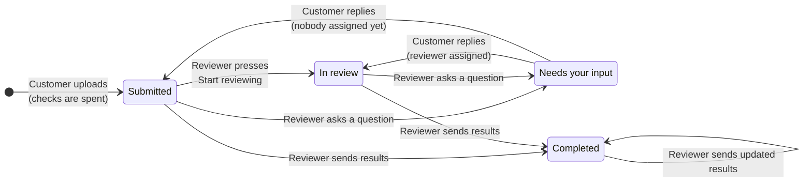

# What happens after a customer uploads

`tests/test_journey.py` walks this whole journey and checks every notification below, so if this page
and the code ever disagree, the tests fail.

## Statuses

| Status | What the customer sees | The timer |
|---|---|---|
| **Submitted** | "Waiting for a reviewer to pick it up." | Counts up from the upload |
| **In review** | "A reviewer is working on your document." | Keeps counting |
| **Needs your input** | The reviewer's question, with a reply box | Paused until they reply |
| **Completed** | Written notes and the marked-up file to download | Stopped; shows the time it took |

Only **Send results** can complete a review, so a customer is never told it's done without feedback.
Reviewers can also set Submitted, In review or Needs your input by hand.

## Who is told what

| Step | Customer | Reviewers |
|---|---|---|
| Upload | Nothing sent; their page shows the live timer | Every reviewer: in-app, plus email if `ADMIN_EMAIL_ALERTS` |
| Reviewer presses Start reviewing | In-app | — |
| Assigned to another reviewer | — | That reviewer: in-app |
| Reviewer sends a message or asks a question | In-app + email | — |
| Status set by hand | In-app (+ email for Needs your input) | — |
| Customer replies | — | The assigned reviewer (or everyone if unassigned): in-app + email |
| **Results sent** | **In-app + email + text** | The timeline records whether the email and text went out |
| Checks added or refunded by an admin | In-app | — |
| Monthly plan renewal fails | In-app + email | — |

Emails need the `SMTP_*` settings and texts need `SMS_PROVIDER`. Without them nothing is lost: in-app
notifications still work, and **Admin > Messages** lists every email and text with Sent, Failed or
Not set up, so you can see exactly what customers were (or weren't) told.
